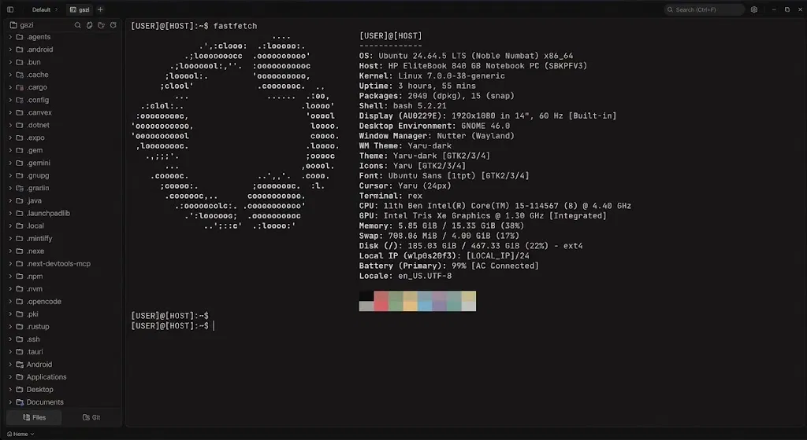

<div align="center">
  
  <h1>Rex</h1>

  <p><strong>O terminal de workspace leve.</strong></p>
</div>

<p align="center">
  <a href="../../README.md">English</a> |
  <a href="README.zh-CN.md">简体中文</a> |
  <a href="README.es.md">Español</a> |
  <a href="README.de.md">Deutsch</a> |
  <a href="README.fr.md">Français</a> |
  <a href="README.ja.md">日本語</a> |
  <a href="README.ko.md">한국어</a> |
  <a href="README.pt-BR.md">Português</a> |
  <a href="README.pl.md">Polski</a> |
  <a href="README.ru.md">Русский</a> |
  <a href="README.id.md">Bahasa Indonesia</a> |
  <a href="README.hi.md">हिन्दी</a>
</p>

---



Rex é um terminal de workspace leve e de código aberto construído com Tauri 2 + Rust e React 19. Um terminal acelerado por GPU e um editor de código em um único app nativo e rápido, com explorador de arquivos, controle de versão com grafo do git e um painel de preview web embutidos. Cerca de 7-8 MB em disco. Sem telemetria. Sem conta.

## Funcionalidades

### Terminal

- Renderização acelerada por GPU: WebGPU por padrão, WebGL como fallback (modelo de terminal libghostty-vt)
- Múltiplas abas com streaming em segundo plano, divisões horizontais e verticais
- Entrada de comandos baseada em blocos com integração de shell (OSC 7 / OSC 133)
- Backend PTY nativo via `portable-pty` (zsh, bash, pwsh, fish, cmd)
- Busca em linha, detecção de links, true-color
- Arraste arquivos do explorador ou da área de trabalho para o terminal como caminhos seguros entre aspas
- Abas privadas
- Ambientes de workspace por aba no Windows (Local, ou qualquer distro WSL instalada)
- Spaces restauram abas, diretórios de trabalho e layouts divididos entre execuções
- CLI `rex` embutida: `rex open <file> --line <n>` abre arquivos a partir de qualquer shell

### Editor de código

- CodeMirror 6 (TS/JS, Rust, Python, Go, C/C++, Java, HTML/CSS, JSON, Markdown e mais)
- Markdown renderizado além de visualização de imagens, vídeos, áudio e PDF
- Suporte opcional a language servers com diagnósticos, navegação, conclusão, formatação e servidores personalizados
- Formatação ao salvar (biome, prettier, ruff, rustfmt, gofmt, clang-format, shfmt, zig ou um comando personalizado)
- Modo Vim
- Temas de editor embutidos: Kanagawa, Catppuccin, Rosé Pine, Everforest, Dracula, Solarized, Nord, Tokyo Night, GitHub e Xcode

### Controle de versão

- Stage / unstage de hunks, commit (Cmd+Enter / Ctrl+Enter), push ciente do upstream
- Exibição e troca de branches, incluindo estado detached HEAD
- Painel de histórico do git com um grafo de commits real (renderização em faixas para merges e branches)
- Busca e filtro de commits, clique para abrir a página do commit remoto
- Geração de mensagem de commit com IA em um clique (envia o diff staged e o nome do repositório para um endpoint gratuito sem chave)

### Explorador de arquivos

- Tema de ícones Catppuccin
- Busca fuzzy, navegação por teclado, renomeação em linha, ações de contexto
- Atualizações ao vivo quando arquivos mudam no disco

### Preview web

- Detecta automaticamente servidores de desenvolvimento locais e os abre em uma aba de preview
- Preview de URLs externas por meio de um webview filho nativo

### Temas e personalização

- Temas personalizados criados no app, alterne entre presets embutidos e os seus
- Crie seus próprios temas, compartilhe ou importe da comunidade
- Imagens de fundo com opacidade e desfoque ajustáveis
- O tema do editor é independente do tema do app

## Instalação

Os instaladores mais recentes estão na página de [Releases](https://github.com/crynta/terax-ai/releases/latest). O Rex se atualiza automaticamente a partir daí.

### Notas do Windows

- Detecção padrão de shell: `pwsh.exe` (PowerShell 7+) -> `powershell.exe` (Windows PowerShell 5.1) -> `cmd.exe`.
- WSL é um ambiente de workspace de primeira classe, não um subprocesso embrulhado.
- As entradas de menu de contexto "Open in Rex" para pastas e unidades são instaladas por usuário.

### Notas do Linux

- **Arch / AUR:** `yay -S terax-bin` (ou `paru`, etc.). Acompanha a versão mais recente.
- **NixOS / Nix**: use o flake oficial - `nix profile install github:crynta/terax-ai` (não NixOS), ou importe o flake e adicione `inputs.rex.packages.${pkgs.system}.rex` ao `environment.systemPackages` (NixOS). A saída `nixosModules.rex` também está disponível para uma configuração mais simples.
- **AppImage:** precisa de FUSE. Sem ele: `./Terax_*.AppImage --appimage-extract-and-run`. No Wayland com falhas de renderização, tente `WEBKIT_DISABLE_DMABUF_RENDERER=1`. Os pacotes `.deb` / `.rpm` linkam contra a pilha GTK do sistema e tendem a ser mais estáveis.

## Compilar do código-fonte

**Pré-requisitos**
- Rust (estável), https://rustup.rs
- Node 22+ e [pnpm](https://pnpm.io)
- Pré-requisitos do Tauri para a sua plataforma, https://tauri.app/start/prerequisites/

**Executar**
```bash
pnpm install
pnpm tauri dev          # desenvolvimento
pnpm tauri build        # bundle de produção
```

**Verificações**
```bash
pnpm lint
pnpm check-types
pnpm test
cd src-tauri && cargo clippy --all-targets --locked -- -D warnings   # lint Rust (igual ao CI)
cd src-tauri && cargo nextest run --locked                           # ou: cargo test --locked
```

## Stack tecnológica

Tauri 2, Rust, `portable-pty`, React 19, TypeScript, Vite, libghostty-vt (Ghostty), CodeMirror 6, Tailwind v4, Zustand.

## Contribuir

Issues e PRs são bem-vindos! Abra issues, sugira funcionalidades ou envie pull requests. Veja [CONTRIBUTING.md](../../CONTRIBUTING.md) e a [documentação de arquitetura](../README.md) para mais detalhes.

## Créditos

Rex é um fork do [Terax](https://github.com/crynta/terax-ai), criado e mantido por [@crynta](https://github.com/crynta). Todo o crédito pelo projeto original vai para o Crynta.

## Assinatura de código

<a href="https://signpath.org"></a>

Os builds do Windows são assinados com um certificado de assinatura de código gratuito fornecido pelo [SignPath.io](https://signpath.io), certificado pela [SignPath Foundation](https://signpath.org).

<br clear="left" />

## Licença

Rex é licenciado sob a Licença Apache-2.0. Para mais informações sobre nossas dependências, veja [Apache License 2.0](../../LICENSE).
